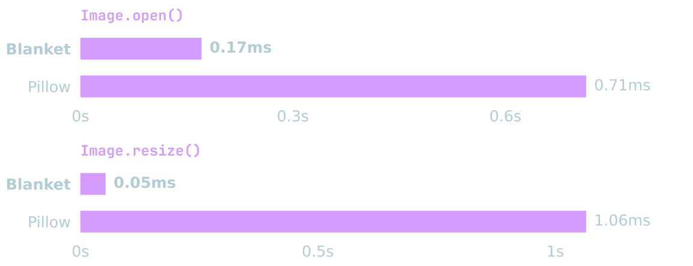

# Blanket

**Image processing in Python. Pixel work in Rust.**

[](https://github.com/ADJB1212/blanket/actions/workflows/CI.yml)

[](LICENSE)
[](https://pepy.tech/projects/pyblanket)

<p align="center">
    
</p>

Blanket is a Pillow-shaped image library with the heavy lifting in Rust:
SIMD kernels, parallel execution, and a Python API that stays out of the way.
Open, transform, and save images with no runtime Python dependencies for CPU use.

```python
from blanket import Image, ImageOps

with Image.open("photo.jpg") as image:
    upright = ImageOps.exif_transpose(image)
    thumbnail = ImageOps.fit(upright, (256, 256), method=Image.Resampling.LANCZOS)
    thumbnail.save("thumbnail.webp", quality=85)
```

[Documentation](https://adjb1212.github.io/blanket-docs/) ·
[API reference](https://adjb1212.github.io/blanket-docs/Image/) ·
[Roadmap](ROADMAP.md) ·
[Issues](https://github.com/ADJB1212/blanket/issues)

## Installation

Python **3.12+**:

```sh
pip install pyblanket
```

Release wheels ship CPU processing plus the platform GPU backend: Metal on
macOS, CUDA on Linux. CPU work needs no GPU stack. An explicit GPU request
raises an error when the hardware or runtime is missing. Setup and
diagnostics are in the [GPU guide](https://adjb1212.github.io/blanket-docs/gpu/).

## Capabilities

- **Familiar surface.** Resize, crop, draw, filter, enhance, composite,
  quantize, and image statistics through Pillow-shaped modules.
- **Real sample depth.** Selected operations keep 10/12/16-bit samples, float
  color, and linear-light resize and compositing.
- **Frames and pages.** Read GIF, WebP, APNG, and TIFF with eager or lazy
  access; write animations and multi-page PDFs.
- **Color and metadata.** ICC transforms, HDR tone mapping, editable EXIF,
  XMP parsing, and metadata rewrites that leave the pixels alone.
- **Encoding.** JPEG controls, coefficient transforms without a recompress,
  and save-time compression search.
- **Interop.** Array imports, binary streams, perceptual hashes, an optional
  Pillow bridge, and explicit Metal/CUDA pipelines.

Blanket is **alpha**. Mode and precision limits are operation-specific, the
API covers a subset of Pillow, and it is not a drop-in for `PIL`. GPU paths
do not promise byte-exact Pillow output. Start with
[getting started](https://adjb1212.github.io/blanket-docs/usage/),
[sample precision](https://adjb1212.github.io/blanket-docs/high-bit-depth/), and
[Pillow interoperability](https://adjb1212.github.io/blanket-docs/pillow-interop/).

## Supported formats

| Support        | Formats                                                                                                                       |
| -------------- | ----------------------------------------------------------------------------------------------------------------------------- |
| Read and write | PNG/APNG, JPEG, JPEG XL, TIFF, WebP, AVIF, HEIC/HEIF, BMP, GIF, ICO, Netpbm/PAM, TGA, QOI, JPEG 2000, PCX, SGI, XBM, XPM, MSP |
| Read only      | DDS, EPS, FITS, SPIDER, Pixar, Sun raster                                                                                     |
| Write only     | PDF, PALM                                                                                                                     |

What actually works depends on mode, depth, and the codec backends in the
build. EPS needs Ghostscript. TIFF writes a single page; PDF can write many.
`features.blanketinfo()` reports the installed build. Encoder settings and
limits are in the [format guide](https://adjb1212.github.io/blanket-docs/formats/).

JPEG saves keep EXIF and ICC profiles. Pass `xmp=image.info.get("xmp")` if
you want XMP to come along. Retention rules and pixel-preserving edits are
in the [metadata guide](https://adjb1212.github.io/blanket-docs/metadata/).

## Development

Source builds use the nightly Rust toolchain pinned in `rust-toolchain.toml`
for portable SIMD. Install the
[native prerequisites](https://adjb1212.github.io/blanket-docs/development/), then:

```sh
uv sync --no-install-project --dev
uv run --no-sync maturin develop -G dev --uv
uv run --no-sync pytest tests/test_api.py
uv run --no-sync scripts/verify_behavior.py
```

Native code is in [`crates/`](crates/), the Python API in
[`python/blanket/`](python/blanket/), tests in [`tests/`](tests/).
Fixes and features need a focused regression test. Build options are in the
[development guide](https://adjb1212.github.io/blanket-docs/development/);
timing comparisons are in the
[benchmark guide](https://adjb1212.github.io/blanket-docs/benchmarking/).
Benchmarks expect a release build.

## License

Original source is [MIT](LICENSE). Official wheels bundle GPL components and
ship as GPL-3.0-or-later, with third-party notices and corresponding source.
Details are in [distribution licenses](THIRD_PARTY_LICENSES.md).
