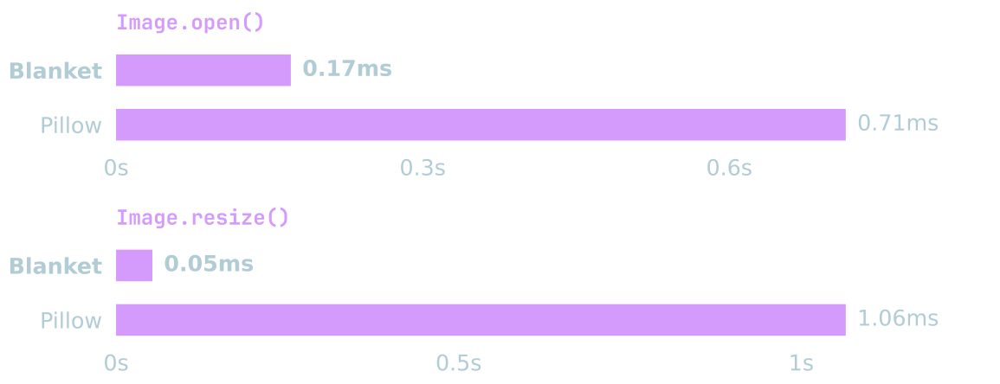

# Blanket

**Image processing in Python. Pixel work in Rust.**

[](https://github.com/ADJB1212/blanket/actions/workflows/CI.yml)

[](LICENSE)
[](https://pepy.tech/projects/pyblanket)

<p align="center">
    
</p>

Blanket is for when you want to write `image.resize(...)` and get on with your
day. The API feels like Pillow, and Rust does the heavy lifting with SIMD kernels
and parallel execution. Open, transform, and save images on the CPU with no
runtime Python dependencies.

Start with a sideways photo. Give it a turn, fit it to a square, and save it
as a WebP thumbnail.

```python
from blanket import Image, ImageOps

with Image.open("photo.jpg") as image:
    upright = ImageOps.exif_transpose(image)
    thumbnail = ImageOps.fit(upright, (256, 256), method=Image.Resampling.LANCZOS)
    thumbnail.save("thumbnail.webp", quality=85)
```

[Documentation](https://adjb1212.github.io/blanket-docs/) ·
[API reference](https://adjb1212.github.io/blanket-docs/Image/) ·
[Roadmap](ROADMAP.md) ·
[Issues](https://github.com/ADJB1212/blanket/issues)

## Installation

With Python **3.12+**, one install gets you going.

```sh
pip install pyblanket
```

For CPU work, you're ready to go. The same wheels include Metal on macOS and
CUDA on Linux. Ask for the GPU and Blanket raises an error if the hardware or
runtime is missing. See setup and diagnostics in the
[GPU guide](https://adjb1212.github.io/blanket-docs/gpu/).

## Capabilities

- **Reach for the familiar tools.** Resize, crop, draw, filter, enhance,
  composite, quantize, and gather image statistics through Pillow-shaped modules.
- **Keep the extra bits.** Selected operations preserve 10/12/16-bit samples and
  float color. Resize and composite in linear light where supported.
- **Make room around the subject.** `image.seam_carve(size)` shrinks or enlarges
  images while favoring prominent color and alpha edges.
- **Polar resampling.** `image.polar(size, scaling="log")` unwraps
  radius into columns and angle into rows; `image.polar_map()` builds reusable
  linear or log-polar coordinate maps for sampling with constant, clamp,
  reflect, or wrap borders.
- **Flip through frames and pages.** Read GIF, WebP, APNG, and TIFF all at once
  or on demand. Write animations and multi-page PDFs.
- **Color and metadata.** ICC transforms, HDR tone mapping, editable EXIF,
  XMP parsing, and metadata rewrites that leave the pixels alone.
- **Make every byte count.** Tune JPEG encoding, transform coefficients without
  recompressing, or have Blanket search for a smaller encoding when you save.
- **Progress and cancellation.** Pass `progress=callback` to receive checkpoint
  numbers starting at zero. Set `show_progress=True` on `open()`, `decode()`,
  `open_region()`, `load()`, `seek()`, `resize()`, or `seam_carve()` to show a tqdm
  checkpoint counter. For `save()` and `encode()`, set it on the compressor.
  If tqdm is unavailable, the operation proceeds without a display.
- **Quality scoring.** Native SSIM, MS-SSIM, and SSIMULACRA2 through
  `ImageMetrics`, preserving integer sample depth.
- **Find the near-duplicates.** `ImageHash` provides average, difference,
  perceptual, color-distribution, and crop-resistant local-texture hashes with
  hexadecimal serialization and Hamming distance. Use
  `ImageHash.nearest_neighbors` to find matches within a Hamming radius and
  `ImageHash.group_hashes` to group hashes connected by matches.
- **Set up the edit once.** Give `ImageBatch.Pipeline` a stack of images or file
  paths. It can run transforms in parallel and stream results in input order,
  with a cap on pending work.
- **Interop.** Array imports (including float16), fused NumPy/PyTorch exports,
  binary streams, perceptual hashes, a shared Pillow bridge, native capsules,
  and explicit Metal/CUDA pipelines.

Blanket is **alpha**. Mode and precision limits are operation-specific, the
API covers a subset of Pillow, and it is not a drop-in for `PIL` (yet). GPU paths
do not promise byte-exact Pillow output. Start with
[getting started](https://adjb1212.github.io/blanket-docs/usage/),
[sample precision](https://adjb1212.github.io/blanket-docs/high-bit-depth/), and
[Pillow interoperability](https://adjb1212.github.io/blanket-docs/pillow-interop/).

## Supported formats

| Support        | Formats                                                                                                                                |
| -------------- | -------------------------------------------------------------------------------------------------------------------------------------- |
| Read and write | PNG/APNG, JPEG, JPEG XL, TIFF, OpenEXR, WebP, AVIF, HEIC/HEIF, BMP, GIF, ICO, Netpbm/PAM, TGA, QOI, JPEG 2000, PCX, SGI, XBM, XPM, MSP |
| Read only      | DDS, EPS, FITS, SPIDER, Pixar, Sun raster                                                                                              |
| Write only     | PDF, PALM                                                                                                                              |
| Read and trace | SVG                                                                                                                                    |

The file extension only tells part of the story. Support also depends on mode,
depth, and the codec backends in your build. EPS needs Ghostscript. TIFF writes
a single page, while PDF can write many.
Curious what your build can handle? Run `features.blanketinfo()`. For encoder
settings and limits, see the
[format guide](https://adjb1212.github.io/blanket-docs/formats/).

JPEG saves keep EXIF and ICC profiles. Pass `xmp=image.info.get("xmp")` if
you want XMP to come along. Retention rules and pixel-preserving edits are
in the [metadata guide](https://adjb1212.github.io/blanket-docs/metadata/).

## Deterministic execution

Need the same result on the next CPU run? Set `BLANKET_DETERMINISTIC=1` before
starting Python. Blanket works through pixel partitions and compression
candidates in serial order. `ImageBatch.Pipeline` takes sources one
at a time in input order, even when given a larger `max_workers`. Each call to
`image.effect_spread()` or `ImagePalette.random()` starts from the same seed.

```sh
BLANKET_DETERMINISTIC=1 python process_images.py
```

Serial execution can be slower. Use the same Blanket build, platform, codec
backends, inputs, and options when comparing results. GPU execution, worker
scheduling internal to codecs without thread controls, and randomness inside
user-supplied pipeline steps are outside this setting.

## Development

Source builds use the nightly Rust toolchain pinned in `rust-toolchain.toml`
for portable SIMD. Install the
[native prerequisites](https://adjb1212.github.io/blanket-docs/development/), then:

```sh
uv sync --no-install-project --dev
uv run --no-sync maturin develop -G dev --uv
uv run --no-sync pytest tests/test_api.py
uv run --no-sync scripts/verify_behavior.py
```

Follow a pixel into [`crates/`](crates/) for native code, or start in
[`python/blanket/`](python/blanket/) for the public API. Add a focused regression
test in [`tests/`](tests/) with your fix or feature. For build options, see the
[development guide](https://adjb1212.github.io/blanket-docs/development/).
If you're bringing a stopwatch, use a release build and follow the
[benchmark guide](https://adjb1212.github.io/blanket-docs/benchmarking/).

## License

Original source is [MIT](LICENSE). Official wheels bundle GPL components and
ship as GPL-3.0-or-later, with third-party notices and corresponding source.
Details are in [distribution licenses](THIRD_PARTY_LICENSES.md).
